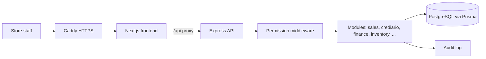

# Lumine

**A full management system for a dance apparel store, built and running in production.** Inventory, point of sale, store credit with installments, receivables and payables, supplier orders, customer records, audit log, analytics and automatic business insights. It replaced a generic monthly-fee ERP and runs on a single small VPS for about R$ 31 a month.

*Sistema de gestão sob medida para a Lumine, loja de artigos de dança: estoque, PDV, crediário, financeiro, pedidos, clientes, analytics e insights.*

## Highlights

- **14 backend modules** with role-based permissions: auth, products, inventory, sales (POS), customers, store credit (crediário), finance (receivables, payables, card fees), supplier orders, upload, analytics, insights, audit, settings.
- **Store credit engine** with installment schedules that never lose a cent to rounding, renegotiation, overdue tracking and card-fee aware net revenue.
- **Bulk product import** from spreadsheets with a preview and confirm step before anything is written.
- **Analytics and insights** (revenue by period, top products, categories, stock alerts and sales patterns) with Recharts dashboards.
- **Audit trail** on sensitive actions, indexed by user.
- **Production setup:** Docker Compose behind Caddy (automatic HTTPS) on a Hetzner VPS, CI with lint, Jest unit and integration tests against a real Postgres service, and deploy on push via GitHub Actions.

## Stack

| Layer | Technology |
| --- | --- |
| Frontend | Next.js 14 (App Router), TypeScript, Tailwind CSS, shadcn/ui, TanStack Query, Recharts, React Hook Form, Zod |
| Backend | Node.js, Express, TypeScript, Prisma ORM |
| Database | PostgreSQL 16 (20 models, versioned migrations) |
| Auth | JWT in httpOnly cookies, bcrypt, permission middleware |
| Infra | Docker, Caddy, Hetzner VPS, GitHub Actions (CI and deploy) |
| Tests | Jest (unit and integration) |

## Architecture



## Running locally

Requirements: Node.js 20, Docker.

```bash
cp .env.example backend/.env
docker compose -f docker/docker-compose.dev.yml up -d   # Postgres

cd backend
npm install
npx prisma migrate dev
npm run db:seed        # categories and a first admin user
npm run dev            # http://localhost:4000

cd ../frontend
npm install
npm run dev            # http://localhost:3000
```

The seed creates a local admin account; see `backend/prisma/seed.ts` and change the password before any real use.

## Layout

```
backend/    Express API, Prisma schema and migrations, modules, middleware, tests
frontend/   Next.js app (dashboard routes per module)
docker/     Dockerfiles and Compose files for dev and production
docs/       architecture, database, infrastructure and roadmap notes
```

## License

Proprietary. Source shown as a portfolio sample.
